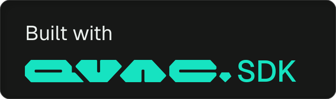

# QVAC MegaLoc Demo

<picture>
  <source media="(prefers-color-scheme: dark)"  srcset="docs/badges/built-with-qvac-dark-mode-landscape.svg">
  <source media="(prefers-color-scheme: light)" srcset="docs/badges/built-with-qvac-light-mode-landscape.svg">
  
</picture>

Show it a street photo of Paris and it finds where the photo was taken. The photo is compared with 10,000 street photos of Saint-Germain and Canal Saint-Martin, on your own machine, in about 100 ms. The closest one gives you the spot, shown on a map.

**MegaLoc**, a visual place recognition model by Gabriele Berton and Carlo Masone, runs through **`@qvac/sdk`**. A game mode puts you against the model: you both guess where a photo was taken, and the closest pin wins the round. No cloud, no account. A free Mapillary token is only needed once, to download the street photos.

## What you get

- **Locate.** Drop, paste or pick a photo. The app embeds it with MegaLoc, ranks the 10,000 indexed photos by similarity and shows the closest match, its position and direction on the map, the next four candidates, and the time it took (embedding and search).
- **You vs MegaLoc.** Five rounds. Each round shows a Paris street photo that is not in the index. You drop a pin, then MegaLoc searches live, and both answers are scored by distance to where the photo was really taken. Three rounds are photos MegaLoc gets right and two are photos it gets wrong, so a person who knows Paris can win some.
- **Seven examples** you can click, with their real position, so you can see how far off the match is.
- **A light map** drawn on a canvas from OpenStreetMap data, with every indexed photo as a dot. Drag to move, scroll to zoom.

## How it works

1. **Fetch.** `mapillary-ids.json` lists 10,000 Mapillary photos we picked: ordinary perspective photos (no 360, no fisheye), one frame every 8 m or 45 degrees per sequence, spread evenly over 25 m cells, with dark and blurry frames removed. `npm run fetch` looks them up with your token and downloads the 1024 px version of each.
2. **Index.** `npm run index` loads MegaLoc and embeds every photo with `embedBatch`. Each photo becomes 8,448 numbers, normalised so that the dot product of two photos is their cosine similarity. The rows go to `data/descriptors.f32`. Then it plays the 30 challenge photos of the game against your index and records which ones MegaLoc gets right.
3. **Search.** `npm start` loads the model and the descriptors. A search embeds the new photo with `embed`, then compares it with all 10,000 rows in plain JavaScript. The photo's position is the position of its closest match.

The model never sees coordinates. It only says which known photo looks most like yours, and the coordinates come from that photo.

## Why local AI matters here

A photo can say a lot about where someone lives or goes. Here the photo you search with stays on your machine: it is embedded locally and compared with a database on your disk. Once the photos are downloaded and indexed, a search needs no network at all, so the same approach fits a robot or a phone that has to place itself without a connection.

## Recommended hardware

- Tested on a MacBook Pro M5 Max (Metal): indexing took 4 min 03 s (24 ms per photo), and a search takes 60 to 120 ms.
- The SDK also runs MegaLoc on CUDA, Vulkan or the CPU. On a CPU, expect indexing to take much longer.
- Disk: about 1.6 GB for the photos, 338 MB for the descriptors and 458 MB for the model (`MEGALOC_F16`).
- Memory: about 1.3 GB while the app runs (measured: 465 MB for the server with the descriptors, 880 MB for the SDK's model worker). 8 GB of RAM is enough.

## Requirements

- Node.js 22.17 or later
- `@qvac/sdk` 0.24 or later (installed by `npm install`)
- A free Mapillary client token, for `npm run fetch` only: sign in at [mapillary.com/dashboard/developers](https://www.mapillary.com/dashboard/developers), register an application, and copy its client token

## Install & run

```bash
npm install
cp .env.example .env        # then paste your token after MAPILLARY_TOKEN=
npm run fetch               # downloads the 10,000 street photos (about 1.6 GB)
npm run index               # embeds them with MegaLoc (a few minutes on a recent GPU)
npm start                   # http://127.0.0.1:3111
```

For a quick try, fetch fewer photos: `npm run fetch -- --limit 1000`. The search then covers only part of the area, and the game uses the results we measured on the full set.

Both `fetch` and `index` can be run again after an interruption: photos already downloaded and rows already embedded are kept. Set `PORT` to use another port.

## Project structure

```
qvac-megaloc-demo/
  server.js              HTTP server: loads MegaLoc and the descriptors, /api/locate, /api/challenges
  bin/fetch.mjs          looks up mapillary-ids.json with your token, downloads the photos
  bin/index.mjs          embeds every photo, then measures the challenge photos on your index
  mapillary-ids.json     the 10,000 Mapillary image ids (ids only, no photos)
  public/                the page: index.html, app.js (locate), game.js (You vs MegaLoc), map.js, style.css
  examples/              7 example photos from Wikimedia Commons, with positions
  challenges/            30 game photos from Wikimedia Commons, with positions
  map/map.json           streets, water, parks and labels from OpenStreetMap (ODbL)
  data/                  created by fetch and index, not in git: img/, db.json, descriptors.f32
  CREDITS.md             authors and licences of every photo and of the map data
```

## Data and licences

- **Code:** Apache 2.0 ([LICENSE](./LICENSE)).
- **MegaLoc model:** MIT, by Gabriele Berton and Carlo Masone ([github.com/gmberton/MegaLoc](https://github.com/gmberton/MegaLoc)).
- **Street photos:** Mapillary contributors, CC BY-SA 4.0. They are downloaded with your own token and are not in this repository. The app shows the contributor under the matched photo.
- **Example and challenge photos:** Wikimedia Commons, under CC BY-SA, CC BY, CC0 or public domain. Every file is credited in [CREDITS.md](./CREDITS.md).
- **Map:** © OpenStreetMap contributors, ODbL.

## Known limits

- The index covers two areas of about 1.5 km by 1.5 km each. A photo taken anywhere else gets a wrong answer, with a confident-looking match.
- Streets that look alike (rows of near-identical Haussmann buildings) can be matched to a look-alike hundreds of metres or kilometres away.
- On 500 test searches with photos from another photographer or another day, the first match landed within 50 m of the real spot in 67% of them.
- Mapillary photos can be removed over time. `npm run fetch` reports how many of the 10,000 are no longer available.
- The search compares the photo with every row, which is fine for 10,000 photos. For millions, use an approximate nearest-neighbour index.

## Privacy

The photo you search with is sent from the browser to the server on your own machine (127.0.0.1) and nowhere else. `npm run fetch` talks to the Mapillary API and its image servers, and the SDK downloads the model once. After that, the app runs offline.

## About this example

This is a prototype in the [QVAC examples](../README.md) collection, built to show MegaLoc in the QVAC SDK. It is provided as-is, with no support, no warranty and no SLA. It is not maintained as a product, has not been security-audited, and should not be used with sensitive data in production. See [LICENSE](./LICENSE) for the full Apache 2.0 terms, including the disclaimer of warranty.

- **Use it lawfully.** Only search with photos you have the right to use. Do not use it to find where a person lives, works or goes, or to track anyone.
- **Mapillary terms.** `npm run fetch` calls the Mapillary API with your own token, so that use is subject to the [Mapillary Terms of Use](https://www.mapillary.com/terms). If you share any of the downloaded photos, keep their CC BY-SA 4.0 attribution.

## License

Apache 2.0, see [LICENSE](./LICENSE). The photos and map data keep their own licences, see [CREDITS.md](./CREDITS.md).
